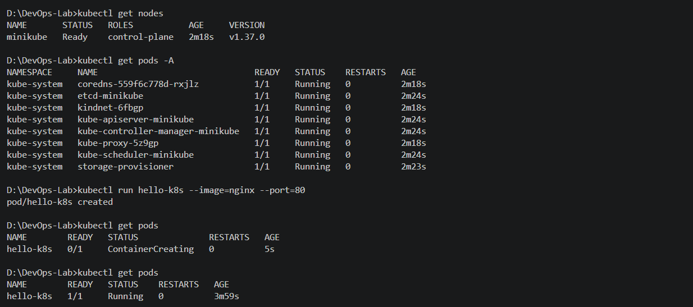
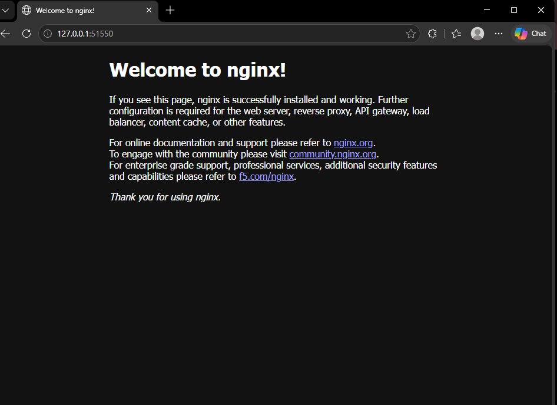
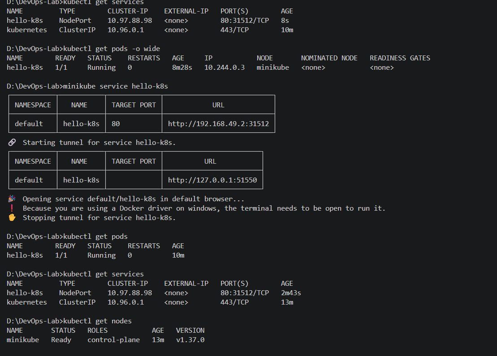

# Kubernetes Hands-On Exercise Series

## Exercise 1: Kubernetes (K8s) — Hello Pod

This exercise introduces the fundamentals of Kubernetes and demonstrates how to deploy and access a containerized application using Minikube.

## Business Problem: Zepto Storefront Example

Imagine you are a DevOps Engineer at Zepto. The product team has developed a lightweight web application for displaying a storefront and delivery status to customers.

Your task is to deploy the application on Kubernetes so that it can run inside a container, be accessed through a service, and be managed by a Kubernetes cluster. For this exercise, the Nginx web server simulates the storefront application.

## Goal

Deploy an Nginx Pod on a local Kubernetes cluster and access it through a NodePort Service.

## Prerequisites

The following tools are required on Windows:

- Docker Desktop
- Minikube
- kubectl
- Visual Studio Code (optional, for editing files)

Docker Desktop must be running before starting Minikube with the Docker driver.

Check the installed tools:

```powershell
docker --version
minikube version
kubectl version --client
```

## Steps: Deploy Nginx on Kubernetes

### 1. Start the local Kubernetes cluster

```powershell
minikube start --driver=docker
```

### 2. Verify that the cluster is ready

```powershell
kubectl get nodes
kubectl cluster-info
```

The Minikube node should reach the `Ready` state.


### 3. Create a Pod using the Nginx image

```powershell
kubectl run hello-k8s --image=nginx --port=80
```

This creates a Pod named `hello-k8s` using the official Nginx container image.

### 4. Verify the Pod

```powershell
kubectl get pods
```

Wait until the Pod status becomes `Running`.



### 5. Expose the Pod using a NodePort Service

```powershell
kubectl expose pod hello-k8s --type=NodePort --port=80
```

Verify the Service:

```powershell
kubectl get services
```

The Service provides a way to access the Nginx application through the Kubernetes cluster.

### 6. Access the Nginx application

```powershell
minikube service hello-k8s
```

This command opens the Service URL in a browser. The exact URL and port are assigned by the local Minikube setup.



The default Nginx welcome page confirms that the web server is accessible.

## Final Verification

Run the following commands to check the deployed resources:

```powershell
kubectl get nodes
kubectl get pods
kubectl get services
```



## Troubleshooting Notes

- **Docker connection error:** Start Docker Desktop and wait until its engine is running.
- **Minikube command not recognized:** Verify that Minikube is installed and reopen the terminal so the updated PATH is loaded.
- **Pod stuck in ContainerCreating:** Wait briefly and inspect the Pod using `kubectl describe pod hello-k8s`.
- **Image pull failure:** Check the internet connection and inspect the Pod events before changing registry or mirror settings.
- **Browser does not open:** Run `minikube service hello-k8s` again and check the terminal output.

## Conclusion

In this exercise, an Nginx application was deployed as a Kubernetes Pod, exposed using a NodePort Service, and accessed through a web browser. This demonstrates the basic workflow of running and exposing a containerized application using Kubernetes.

## Screenshots

Screenshots for this exercise are stored in `Images/exercise-1/`.
