# Exercise 10: Multi-Node Kubernetes Cluster with Multiple Applications and ReplicaSets

## Objective

To deploy two Python Flask applications on a three-node Minikube Kubernetes cluster. The exercise demonstrates Docker image creation, Kubernetes Deployments and Services, replica management, pod anti-affinity, and testing REST API endpoints.

## Storyboard

The exercise simulates an e-commerce platform with two services:

1. **Product Catalog (AppA)** — provides information about available products.
2. **Shopping Cart (AppB)** — allows users to retrieve and add items to a shopping cart.

For availability, Product Catalog is configured with **2 replicas** and Shopping Cart with **3 replicas**. Required pod anti-affinity rules ensure that replicas of the same application are scheduled on different nodes.

## Use Case

An online store needs resilient product browsing and cart services. Distributing replicas across multiple nodes reduces the risk of a single node failure taking down every replica of a service. Anti-affinity helps distribute pods, although complete availability also depends on node health, sufficient resources, networking, and application design.

## Tools Used

- Windows 11
- Visual Studio Code and Command Prompt
- Docker Desktop and Docker
- Minikube and kubectl
- Python and Flask
- Git and GitHub

## Project Structure

The code files are stored in `code/exercise-10/`. All screenshots are stored in `Images/exercise-10/`, and this Markdown report is saved in the project root.

```text
D:\\DevOps-Lab
├── code
│   └── exercise-10
│       ├── product_catalog.py
│       ├── shopping_cart.py
│       ├── Dockerfile.product
│       ├── Dockerfile.shopping
│       ├── product_catalog_deployment.yaml
│       ├── shopping_cart_deployment.yaml
│       ├── product_catalog_service.yaml
│       └── shopping_cart_service.yaml
├── Images
│   └── exercise-10
│       ├── 01-project-directories.png
│       ├── 02-product-catalog-code.png
│       ├── 03-shopping-cart-code.png
│       ├── 04-dockerfiles.png
│       ├── 05-multinode-cluster-ready.png
│       ├── 06-registry-addon.png
│       ├── 07-deployment-yaml.png
│       ├── 08-service-yaml.png
│       ├── 09-docker-build.png
│       ├── 10-images-loaded.png
│       ├── 11-deployments-applied.png
│       ├── 12-pod-distribution.png
│       ├── 13-product-catalog-test.png
│       ├── 14-shopping-cart-test.png
│       └── 15-final-cluster-status.png
└── 10-Multi-Node Kubernetes Cluster.md
```

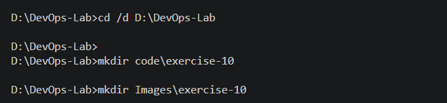

*Figure 1: Project directory structure.*

---

## Step 1: Start a Three-Node Minikube Cluster

Ensure Docker Desktop is running before starting Minikube. The following commands create or start the dedicated `devops-multinode` profile.

```bat
minikube start --nodes 3 -p devops-multinode --driver=docker
kubectl config use-context devops-multinode
kubectl --context devops-multinode get nodes -o wide
```

Wait until the control-plane and both worker nodes show `Ready`. If a worker is temporarily `NotReady`, inspect its status and allow the cluster networking components time to initialize.

Do not run `minikube delete` unless you intentionally want to remove the existing profile and its resources.

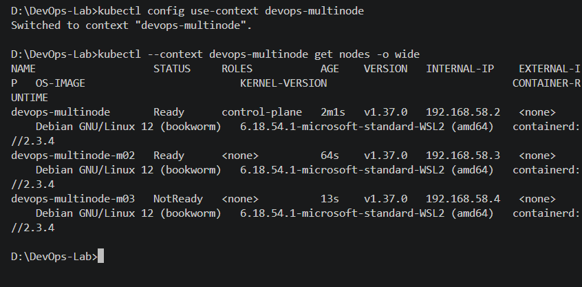

*Figure 2: Three-node Minikube cluster with nodes in Ready state.*

### Platform note: Registry connectivity and node initialization

If Minikube cannot download an image from `registry.k8s.io`, inspect the specific error before changing configuration. A registry mirror may be a workaround in some environments, but the correct choice depends on the network and Minikube version.

Worker nodes can briefly report `NotReady` while the container runtime and CNI networking initialize. Verify again with:

```bat
kubectl --context devops-multinode get nodes
```

## Step 2: Enable the Registry Addon (Optional)

The original exercise enables the Minikube registry addon:

```bat
minikube -p devops-multinode addons enable registry
kubectl --context devops-multinode get pods -n kube-system
```

This addon is optional for this implementation because the application images can be loaded directly into Minikube. If a `registry-proxy` pod shows `ImagePullBackOff`, inspect the pod details; this does not automatically mean the application deployments cannot use locally loaded images.

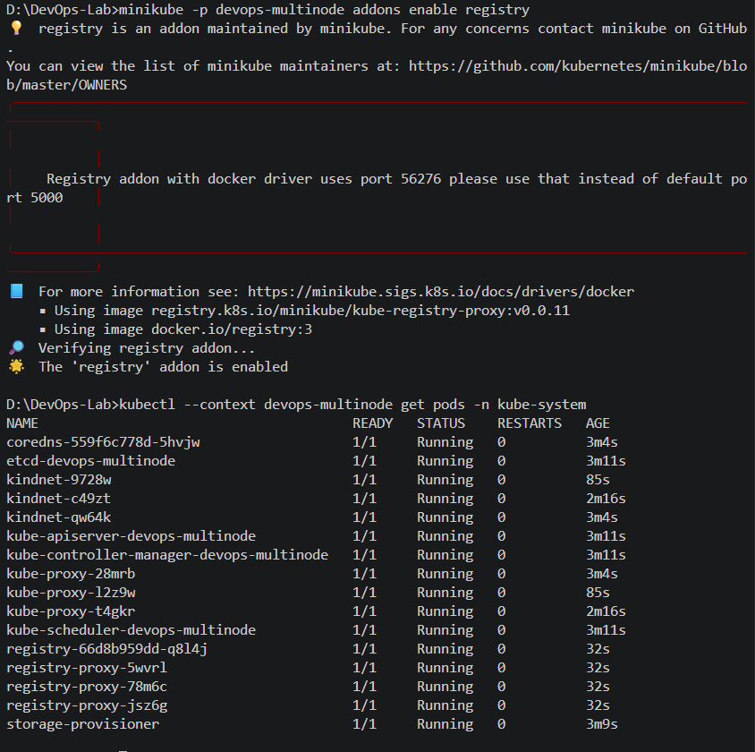

*Figure 3: Registry addon status, if this optional step was performed.*

## Step 3: Product Catalog (AppA) — Flask Application

Create `code/exercise-10/product_catalog.py`.

```python
from flask import Flask, jsonify

app = Flask(__name__)

products = [
    {"id": 1, "name": "Laptop", "price": 1200},
    {"id": 2, "name": "Phone", "price": 800},
    {"id": 3, "name": "Headphones", "price": 150},
]


@app.route("/products", methods=["GET"])
def get_products():
    return jsonify(products)


if __name__ == "__main__":
    app.run(host="0.0.0.0", port=80)
```

The `/products` endpoint returns the available products as JSON.

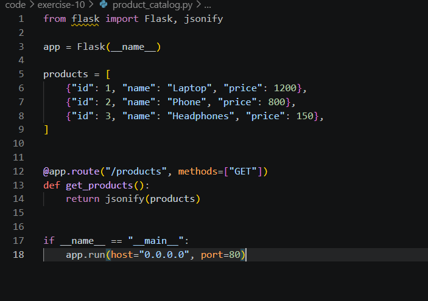

*Figure 4: Product Catalog Flask application.*

## Step 4: Shopping Cart (AppB) — Flask Application

Create `code/exercise-10/shopping_cart.py`.

```python
from flask import Flask, jsonify, request

app = Flask(__name__)

cart = []


@app.route("/cart", methods=["GET"])
def get_cart():
    return jsonify(cart)


@app.route("/cart", methods=["POST"])
def add_to_cart():
    item = request.get_json(silent=True)

    if not isinstance(item, dict):
        return jsonify({"error": "A JSON object is required"}), 400

    cart.append(item)
    return jsonify(cart), 201


if __name__ == "__main__":
    app.run(host="0.0.0.0", port=80)
```

The `/cart` endpoint supports GET requests to retrieve cart items and POST requests to add an item. The cart is held in memory; it is not persistent and is not shared automatically between replicas.

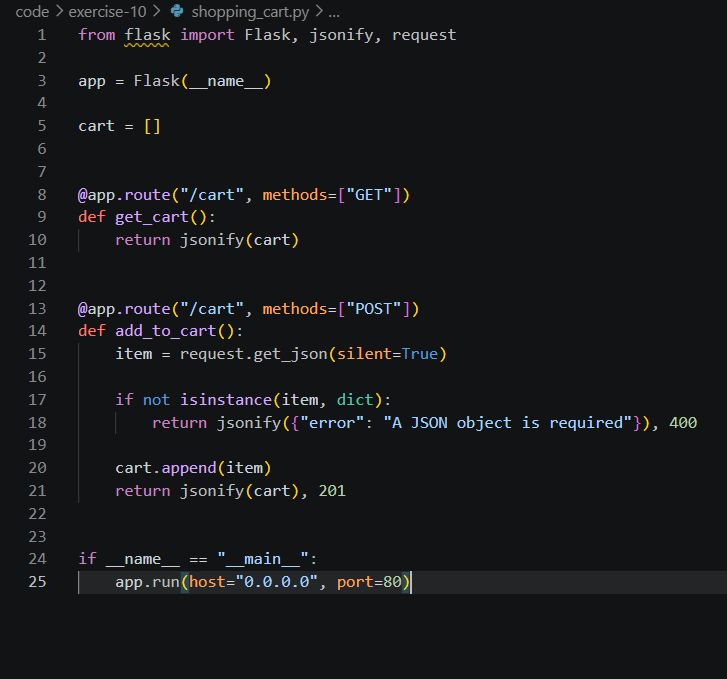

*Figure 5: Shopping Cart Flask application.*

## Step 5: Dockerize Both Applications

Create `code/exercise-10/Dockerfile.product`.

```dockerfile
FROM python:3.12-slim
WORKDIR /app
RUN pip install --no-cache-dir Flask==3.1.1
COPY product_catalog.py /app/
EXPOSE 80
CMD ["python", "product_catalog.py"]
```

Create `code/exercise-10/Dockerfile.shopping`.

```dockerfile
FROM python:3.12-slim
WORKDIR /app
RUN pip install --no-cache-dir Flask==3.1.1
COPY shopping_cart.py /app/
EXPOSE 80
CMD ["python", "shopping_cart.py"]
```

Build both images from the application directory:

```bat
cd /d D:\DevOps-Lab\code\exercise-10

docker build -t product-catalog:latest -f Dockerfile.product .
docker build -t shopping-cart:latest -f Dockerfile.shopping .
docker images
```

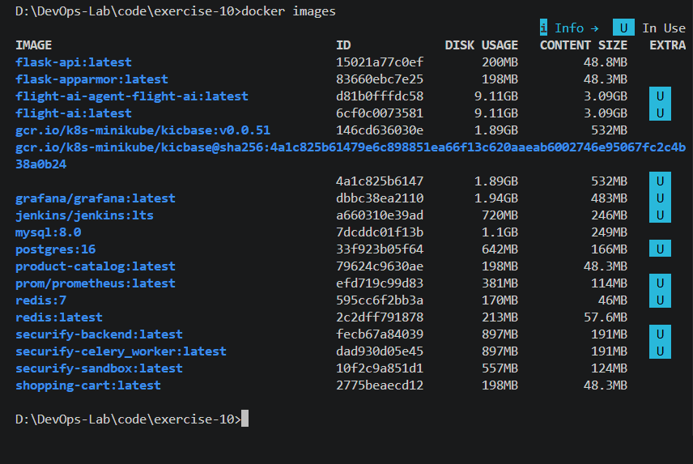

*Figure 6: Docker images built for both Flask applications.*

## Step 6: Load the Images into Minikube

Load the locally built images into the Minikube profile:

```bat
minikube -p devops-multinode image load product-catalog:latest
minikube -p devops-multinode image load shopping-cart:latest
```

The Kubernetes manifests use `imagePullPolicy: Never`, so each image must already be available in the cluster's container runtime.

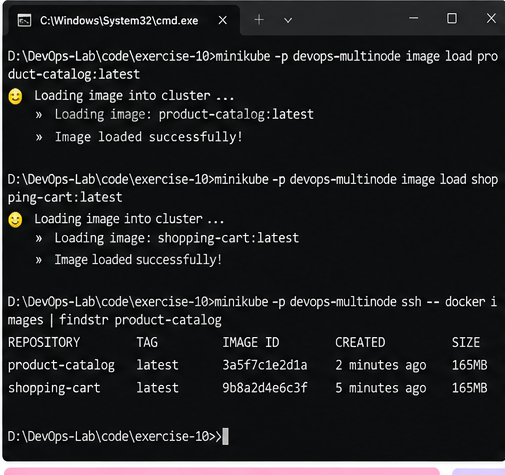

*Figure 7: Application images loaded into Minikube.*

## Step 7: Deploy Product Catalog with Pod Anti-Affinity

Create `code/exercise-10/product_catalog_deployment.yaml`.

```yaml
apiVersion: apps/v1
kind: Deployment
metadata:
  name: product-catalog
  namespace: default
spec:
  replicas: 2
  selector:
    matchLabels:
      app: product-catalog
  template:
    metadata:
      labels:
        app: product-catalog
    spec:
      affinity:
        podAntiAffinity:
          requiredDuringSchedulingIgnoredDuringExecution:
            - labelSelector:
                matchLabels:
                  app: product-catalog
              topologyKey: kubernetes.io/hostname
      containers:
        - name: product-catalog
          image: product-catalog:latest
          imagePullPolicy: Never
          ports:
            - containerPort: 80
```

This Deployment requests two replicas. Required pod anti-affinity prevents replicas labelled `app: product-catalog` from being scheduled on the same node.

## Step 8: Deploy Shopping Cart with Pod Anti-Affinity

Create `code/exercise-10/shopping_cart_deployment.yaml`.

```yaml
apiVersion: apps/v1
kind: Deployment
metadata:
  name: shopping-cart
  namespace: default
spec:
  replicas: 3
  selector:
    matchLabels:
      app: shopping-cart
  template:
    metadata:
      labels:
        app: shopping-cart
    spec:
      affinity:
        podAntiAffinity:
          requiredDuringSchedulingIgnoredDuringExecution:
            - labelSelector:
                matchLabels:
                  app: shopping-cart
              topologyKey: kubernetes.io/hostname
      containers:
        - name: shopping-cart
          image: shopping-cart:latest
          imagePullPolicy: Never
          ports:
            - containerPort: 80
```

This Deployment requests three replicas. Since the anti-affinity rule is required, three schedulable nodes are needed to place all three replicas on separate nodes.

Both manifests use the `default` namespace for consistency. A namespace mismatch between related resources can cause resources to be created in unexpected places or Services to fail to find their intended pods.

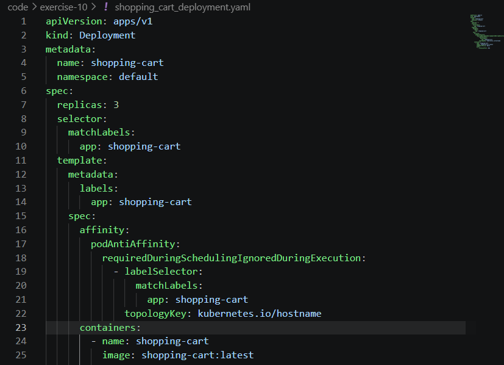

*Figure 8: Deployment manifests with replica counts and required anti-affinity.*

## Step 9: Expose Both Applications with Services

Create `code/exercise-10/product_catalog_service.yaml`.

```yaml
apiVersion: v1
kind: Service
metadata:
  name: product-catalog-service
  namespace: default
spec:
  type: NodePort
  selector:
    app: product-catalog
  ports:
    - protocol: TCP
      port: 80
      targetPort: 80
```

Create `code/exercise-10/shopping_cart_service.yaml`.

```yaml
apiVersion: v1
kind: Service
metadata:
  name: shopping-cart-service
  namespace: default
spec:
  type: NodePort
  selector:
    app: shopping-cart
  ports:
    - protocol: TCP
      port: 80
      targetPort: 80
```

The Services provide stable access to the pods using label selectors.

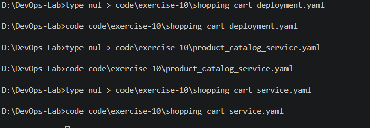

*Figure 9: Service manifests for Product Catalog and Shopping Cart.*

## Step 10: Apply the Deployments and Services

Run the following commands from the code directory:

```bat
cd /d D:\DevOps-Lab\code\exercise-10

kubectl --context devops-multinode apply -f product_catalog_deployment.yaml
kubectl --context devops-multinode apply -f shopping_cart_deployment.yaml

kubectl --context devops-multinode apply -f product_catalog_service.yaml
kubectl --context devops-multinode apply -f shopping_cart_service.yaml
```

Wait for the Deployments to become ready:

```bat
kubectl --context devops-multinode rollout status deployment/product-catalog --timeout=180s
kubectl --context devops-multinode rollout status deployment/shopping-cart --timeout=180s

kubectl --context devops-multinode get deployments
kubectl --context devops-multinode get services
```

Expected replica counts are `2/2` for Product Catalog and `3/3` for Shopping Cart.


*Figure 10: Deployment and Service creation and readiness checks.*

## Step 11: Verify Pod Distribution Across Nodes

Run:

```bat
kubectl --context devops-multinode get pods -o wide
kubectl --context devops-multinode get pods -l app=product-catalog -o wide
kubectl --context devops-multinode get pods -l app=shopping-cart -o wide
```

The expected distribution is:

- **Product Catalog:** two pods on two different nodes.
- **Shopping Cart:** three pods on three different nodes.

The specific node assignment can vary. The important check is that no two replicas of the same application share a node.

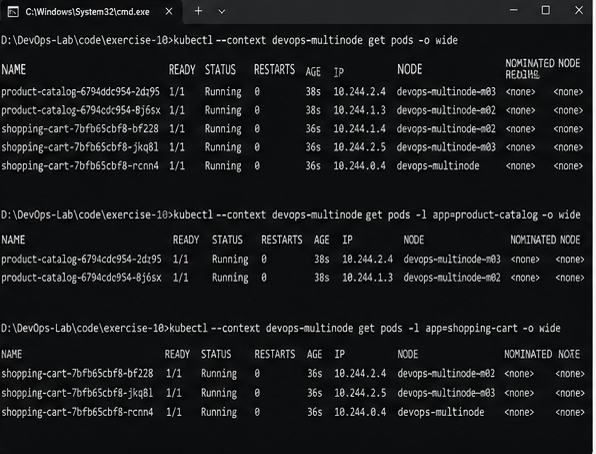

*Figure 11: Pod status and node placement.*

## Step 12: Access and Test Product Catalog

On Windows, use port forwarding to make the Service accessible locally. In one CMD terminal, run and leave this command running:

```bat
kubectl --context devops-multinode port-forward service/product-catalog-service 8081:80
```

In a second terminal, test the endpoint:

```bat
curl.exe http://127.0.0.1:8081/products
```

Expected response:

```json
[
  {"id": 1, "name": "Laptop", "price": 1200},
  {"id": 2, "name": "Phone", "price": 800},
  {"id": 3, "name": "Headphones", "price": 150}
]
```

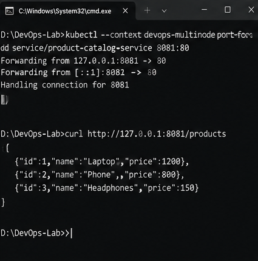

*Figure 12: Product Catalog API returning the product list.*

## Step 13: Access and Test Shopping Cart

In another CMD terminal, run and leave this port-forward command running:

```bat
kubectl --context devops-multinode port-forward service/shopping-cart-service 8082:80
```

Retrieve the cart:

```bat
curl.exe http://127.0.0.1:8082/cart
```

Expected initial response:

```json
[]
```

Add a cart item:

```bat
curl.exe -X POST http://127.0.0.1:8082/cart -H "Content-Type: application/json" -d "{\"id\":1,\"name\":\"Laptop\",\"quantity\":1}"
```

Expected response from the replica handling the request:

```json
[{"id":1,"name":"Laptop","quantity":1}]
```

Each replica maintains its own in-memory cart. Because Service requests may be routed to different replicas, the cart contents may differ between requests. A shared database or other shared storage is required for consistent production behavior.

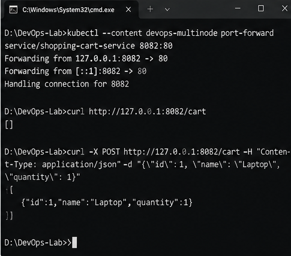

*Figure 13: Shopping Cart API tested using GET and POST requests.*

## Step 14: Final Verification

Run:

```bat
kubectl --context devops-multinode get nodes
kubectl --context devops-multinode get deployments
kubectl --context devops-multinode get services
kubectl --context devops-multinode get pods -o wide
```

Successful verification requires three Ready nodes, two ready Product Catalog replicas, three ready Shopping Cart replicas, and working API endpoints.

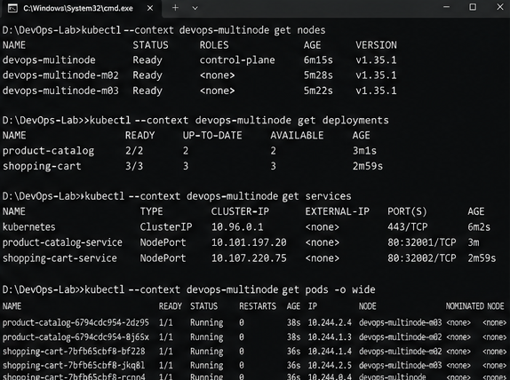

*Figure 14: Final cluster and application status.*

## Result

The exercise configures two Flask applications for deployment on a three-node Minikube cluster. Product Catalog uses two replicas, and Shopping Cart uses three replicas. Required pod anti-affinity spreads replicas of each application across different nodes. Kubernetes Services expose the applications, and HTTP requests verify their API behavior.

## Conclusion

This exercise demonstrates Docker image creation, loading local images into Minikube, Kubernetes Deployments, replica management, pod anti-affinity, Services, and REST API testing. Distributing replicas across nodes can improve resilience, but actual availability also depends on resources, health checks, networking, and data persistence.

## Key Takeaways

- Deployments maintain the desired number of replicas.
- `requiredDuringSchedulingIgnoredDuringExecution` is a hard pod anti-affinity rule. If no eligible node is available, a pod can remain Pending rather than violate the rule.
- Kubernetes Services provide stable endpoints for accessing pods.
- Local images can be loaded into Minikube without relying on a remote registry for the application images.
- Namespace consistency is important for related Kubernetes resources.
- In-memory data is not shared between replicas; production cart data should be stored in a shared persistent system.

## Future Enhancements

- Add a shared database for Shopping Cart persistence.
- Configure readiness and liveness probes.
- Set CPU and memory requests and limits.
- Add Ingress, monitoring, and centralized logging.
- Integrate the applications into a CI/CD pipeline.

## Screenshot Note

All image links above use the relative path `Images/exercise-10/`. Keep the screenshot files in that folder when pushing the report to GitHub. Screenshots should be genuine captures of the actual environment if they are being used as execution evidence.
