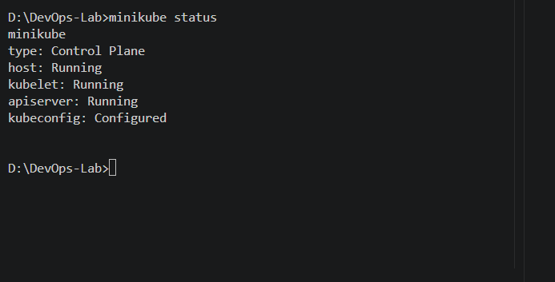
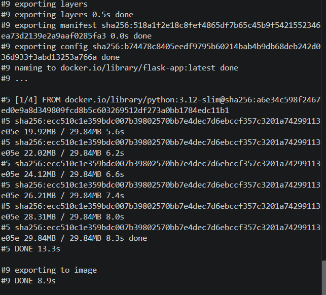
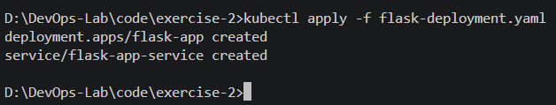
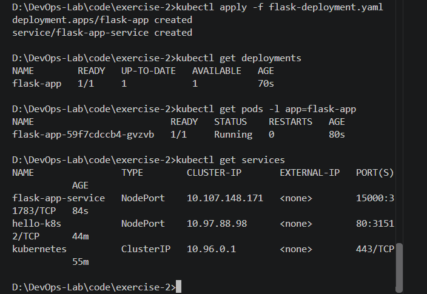
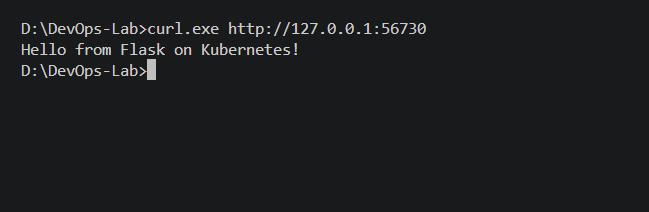

# Kubernetes Hands-On Exercise Series

## Exercise 2: Deploy a Flask App on Minikube using Docker and YAML

## Objective

Deploy a Python Flask application on a local Kubernetes cluster using a custom Docker image, a Kubernetes Deployment, and a NodePort Service.

## Steps

### 1. Confirm Minikube is running

Check the status of the Minikube cluster:

```powershell
minikube status
```

The host, kubelet, and API server should be running.



### 2. Create the Flask application

Create `app.py` inside `code/exercise-2/`.

```python
from flask import Flask

app = Flask(__name__)

@app.route("/")
def home():
    return "Hello from Flask on Kubernetes!"

if __name__ == "__main__":
    app.run(host="0.0.0.0", port=15000)
```

The application returns a message when a client accesses the root route.

### 3. Create the Dockerfile

Create a file named `Dockerfile` in the same directory.

```dockerfile
FROM python:3.12-slim

WORKDIR /app

COPY app.py .

RUN pip install --no-cache-dir flask

EXPOSE 15000

CMD ["python", "app.py"]
```

The Dockerfile packages the Python application and its Flask dependency into a container image.

### 4. Build the Docker image

On Windows, build the image directly for Minikube:

```powershell
minikube image build -t flask-app:latest .
```

Run this command from `code/exercise-2/`.



### 5. Create the Deployment and Service YAML

Create `flask-deployment.yaml` inside `code/exercise-2/`.

The file defines a Deployment named `flask-app` with one replica and a NodePort Service named `flask-app-service`. The container listens on port 15000.

The image uses `imagePullPolicy: Never` because it has already been built inside Minikube.

See the complete manifest: [flask-deployment.yaml](code/exercise-2/flask-deployment.yaml).

### 6. Deploy the application

Apply the Kubernetes manifest:

```powershell
kubectl apply -f flask-deployment.yaml
```



### 7. Verify the Deployment, Pod, and Service

Run the following commands:

```powershell
kubectl get deployments
kubectl get pods -l app=flask-app
kubectl get services
```

The Deployment should show one available replica, the Pod should reach the Running state, and the Service should be listed as NodePort.



### 8. Access the Flask application

Run:

```powershell
minikube service flask-app-service --url
```

Keep the terminal open if Minikube starts a tunnel. Open a second terminal and use the URL returned by Minikube:

```powershell
curl.exe http://127.0.0.1:PORT
```

Replace `PORT` with the actual port printed by Minikube.

Expected response:

```text
Hello from Flask on Kubernetes!
```



## Troubleshooting Notes

- **Minikube is not recognized:** Verify the installation and Windows PATH, then reopen the terminal.
- **Image pull error:** Ensure the image was built for Minikube and check that `imagePullPolicy` is set to `Never`.
- **Pod not running:** Inspect the Pod using `kubectl describe pod -l app=flask-app` and review its events.
- **Service connection failure:** Keep the Minikube service tunnel terminal open and use the exact URL it prints.

## Conclusion

The Flask application was packaged into a custom Docker image, deployed on Minikube using a Kubernetes Deployment and Service, and accessed successfully through a local URL. The successful HTTP response confirms that the application is reachable through the Kubernetes Service.
