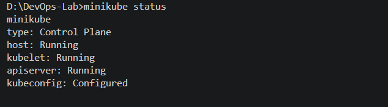
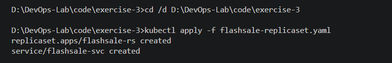
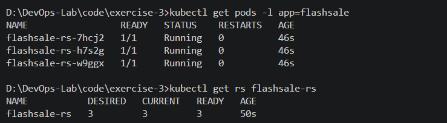
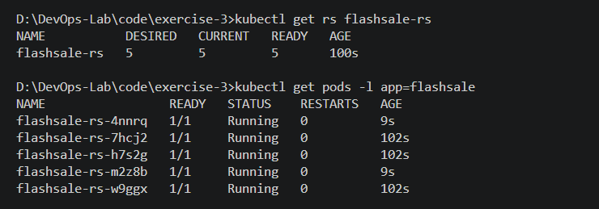
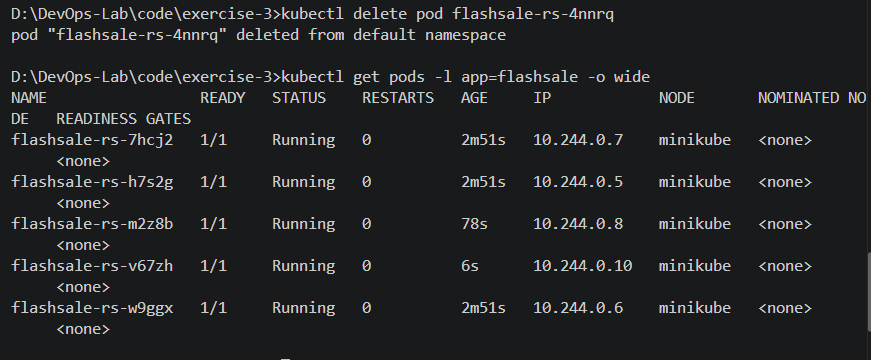

# Kubernetes Hands-On Exercise Series

## Exercise 3: Scaling a Flask App Using ReplicaSets

## Real-Life Use Case: E-commerce Flash Sale

During a major e-commerce sale, such as Big Billion Days or Prime Day, traffic can increase dramatically. A single application Pod may not be sufficient to handle the increased demand.

Kubernetes ReplicaSets maintain a desired number of identical Pods. Scaling the replicas increases the number of application instances, while self-healing replaces Pods that are deleted or fail.

## Objective

- Understand ReplicaSets and Pods.
- Scale a Flask application from three to five replicas.
- Observe Pod health and automatic replacement.
- Configure health probes and container resource limits.

## Application: Flash Sale Checkout Service

The Flask application provides three endpoints:

- `/` — returns a welcome message and the serving Pod's hostname.
- `/buy` — simulates a purchase and returns a randomly selected product.
- `/health` — reports application health for Kubernetes probes.

The source code is available in [app.py](code/exercise-3/app.py).

## Step 1: Confirm Minikube Is Running

```powershell
minikube status
```



## Step 2: Build the Docker Image

The Dockerfile uses Python 3.11, Flask, and Gunicorn to package the application.

```powershell
minikube image build -t flashsale:1.0 .
```

Run this command from `code/exercise-3/`. Building through Minikube makes the image available to the local Kubernetes cluster.


## Step 3: Create the ReplicaSet and Service

The manifest is available in [flashsale-replicaset.yaml](code/exercise-3/flashsale-replicaset.yaml).

The ReplicaSet initially specifies three replicas. It includes readiness and liveness probes that call `/health`, along with CPU and memory requests and limits.

The `flashsale-svc` ClusterIP Service selects Pods labelled `app: flashsale` and forwards port 80 to container port 5000.

## Step 4: Apply the Manifest

```powershell
kubectl apply -f flashsale-replicaset.yaml
```



## Step 5: Verify the Initial Pods

```powershell
kubectl get pods -l app=flashsale
kubectl get rs flashsale-rs
```

The expected state is three ready Pods, with the ReplicaSet reporting three desired, current, and ready replicas.



## Step 6: Scale Up to Five Replicas

```powershell
kubectl scale rs flashsale-rs --replicas=5
kubectl get rs flashsale-rs
kubectl get pods -l app=flashsale
```

Kubernetes creates two additional Pods to reach the desired count of five.



## Step 7: Delete a Pod and Observe Self-Healing

First, identify a Pod belonging to the flashsale ReplicaSet:

```powershell
kubectl get pods -l app=flashsale
```

Delete one actual Pod by replacing `POD_NAME` with its name:

```powershell
kubectl delete pod POD_NAME
```

Observe the Pods:

```powershell
kubectl get pods -l app=flashsale -o wide
```

The ReplicaSet controller should create a replacement Pod and work to restore the desired count of five.



## Key Observations

- **Scaling:** Increasing the desired replica count from three to five creates two additional Pods.
- **Self-healing:** Deleting a managed Pod causes the ReplicaSet controller to create a replacement.
- **Health checks:** Readiness and liveness probes monitor the application's health.
- **Resource management:** CPU and memory requests and limits are configured for each container.
- **Pod distribution:** All five replicas run on the single Minikube node in this exercise.

## Questions and Answers

**Q1. How many replicas were initially configured?**

Three replicas.

**Q2. What happens when the replica count is increased to five?**

Kubernetes creates two additional Pods to reach the desired count.

**Q3. What happens when a managed Pod is deleted?**

The ReplicaSet controller creates a replacement to restore the desired replica count.

**Q4. How does a ReplicaSet maintain the desired count?**

It continuously compares the actual number of matching Pods with the desired number and creates replacements when needed.

**Q5. How many Kubernetes nodes were used?**

One local Minikube node.

## Conclusion

This exercise demonstrates ReplicaSet scaling, health probes, resource configuration, and self-healing in Kubernetes. The application was configured to run three replicas initially, scaled to five replicas, and tested by deleting a Pod and observing its replacement.
