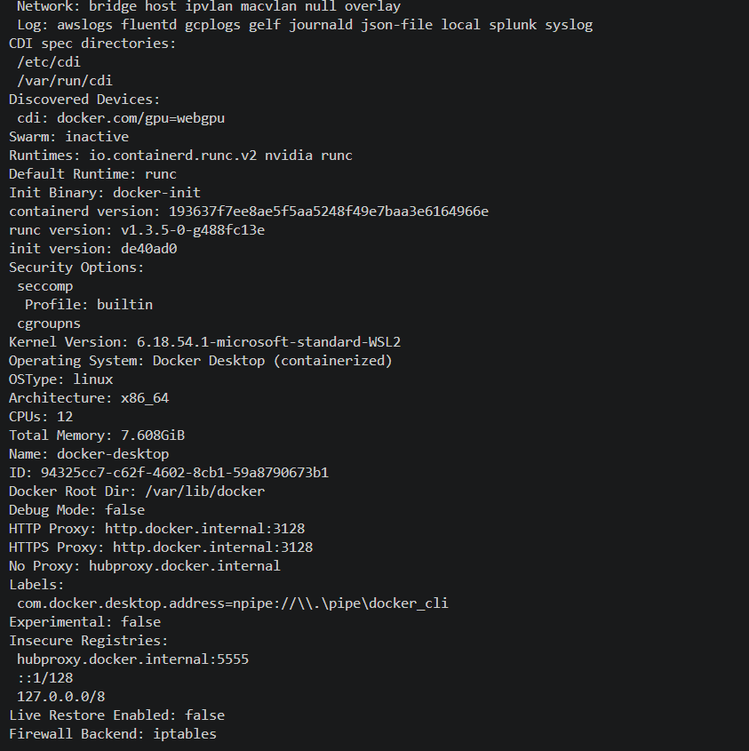
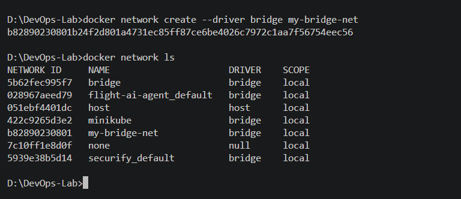
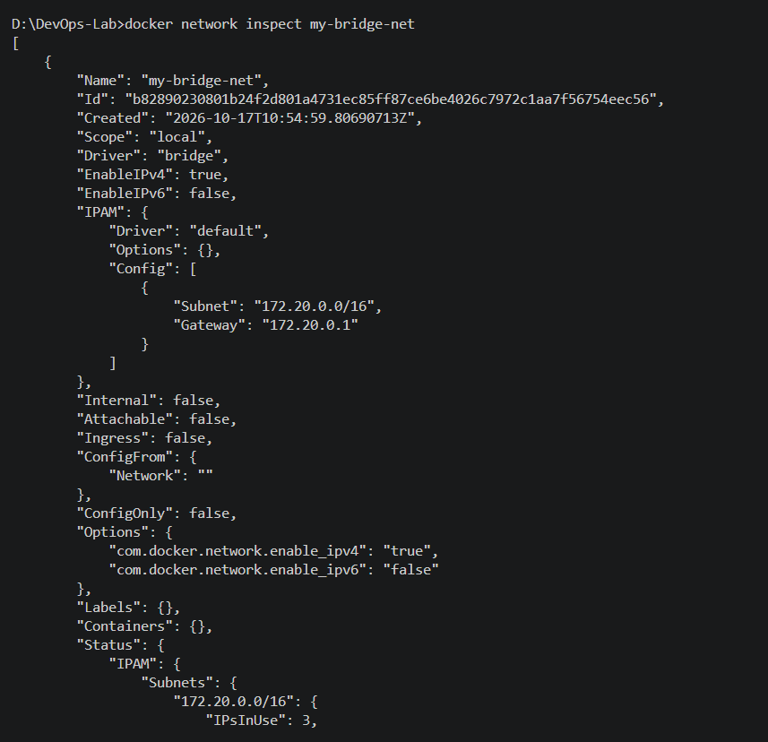
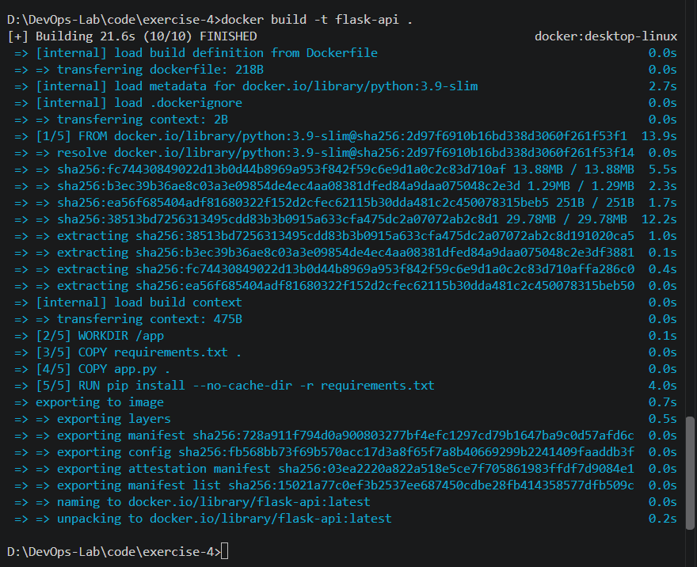
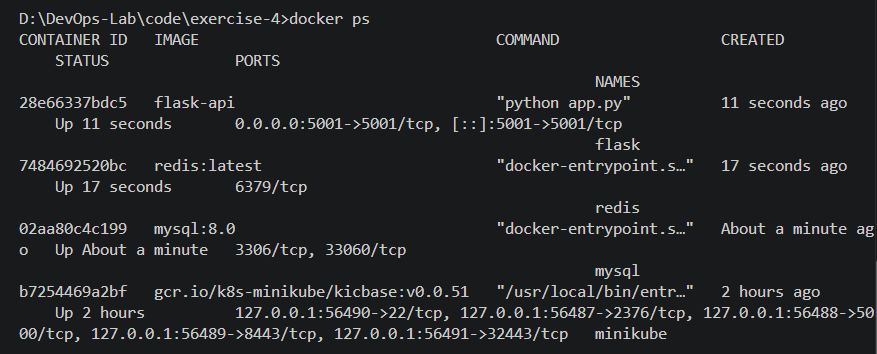
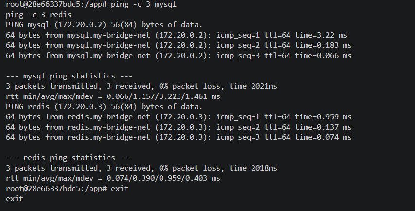
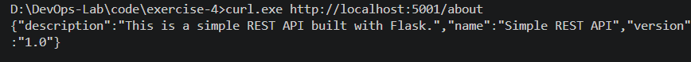

# Docker Hands-On Exercise Series

## Exercise 4: Docker Networking with Multiple Containers

## Objective

Understand Docker networking concepts and configure a multi-container application where services communicate over a custom bridge network.

## Scenario

A simple web application consists of three containers:

- **Flask:** Provides a REST API.
- **MySQL:** Provides a relational database service.
- **Redis:** Provides a caching service.

All three containers are connected to a custom Docker bridge network so they can communicate using container names.

## Step 1: Verify Docker Is Running

Run the following command to verify that Docker Desktop is running correctly:

```cmd
docker info
```

The command displays Docker client and server information.



## Step 2: Create a Custom Bridge Network

Create a user-defined bridge network:

```cmd
docker network create --driver bridge my-bridge-net
```

Verify the available Docker networks:

```cmd
docker network ls
```

The `my-bridge-net` network should appear with the `bridge` driver.



## Step 3: Inspect the Network

Inspect the configuration of the custom network:

```cmd
docker network inspect my-bridge-net
```

The output displays the network driver, subnet, gateway, and connected containers. Before containers are attached, the `Containers` section is empty.



## Step 4: Create the Flask REST API

Create `app.py` inside `code/exercise-4/`.

```python
from flask import Flask, jsonify

app = Flask(__name__)

@app.route("/about", methods=["GET"])
def about():
    return jsonify({
        "name": "Simple REST API",
        "version": "1.0",
        "description": "This is a simple REST API built with Flask."
    })

if __name__ == "__main__":
    app.run(debug=False, host="0.0.0.0", port=5001)
```

Create `requirements.txt`:

```text
Flask==2.0.1
Werkzeug==2.0.3
```

Werkzeug is pinned to a compatible version to avoid an import error caused by changes in newer releases.

Create a `Dockerfile`:

```dockerfile
FROM python:3.9-slim

WORKDIR /app

COPY requirements.txt .
COPY app.py .

RUN pip install --no-cache-dir -r requirements.txt

EXPOSE 5001

CMD ["python", "app.py"]
```

## Step 5: Build the Flask Image

From the `code/exercise-4/` directory, build the Docker image:

```cmd
docker build -t flask-api .
```

The image contains the Flask application and its dependencies.



## Step 6: Launch All Three Containers

Start the MySQL container with a root password:

```cmd
docker run -d --name mysql --network my-bridge-net -e MYSQL_ROOT_PASSWORD=rootpass mysql:8.0
```

Start Redis:

```cmd
docker run -d --name redis --network my-bridge-net redis:latest
```

Start Flask and publish port 5001 to the host:

```cmd
docker run -d --name flask --network my-bridge-net -p 5001:5001 flask-api
```

Verify the running containers:

```cmd
docker ps
```

The output should show the MySQL, Redis, and Flask containers running.



## Step 7: Test Connectivity Between Containers

Open a shell inside the Flask container:

```cmd
docker exec -it flask bash
```

The slim Python image does not include the `ping` utility by default. Install it temporarily inside the container:

```bash
apt-get update && apt-get install -y iputils-ping
```

Test connectivity to MySQL and Redis by their container names:

```bash
ping -c 3 mysql
ping -c 3 redis
```

Both names should resolve to container IP addresses, and successful replies demonstrate connectivity over the custom bridge network.

Exit the container:

```bash
exit
```



## Step 8: Test the Flask API From the Host

Run the following command from the Windows terminal:

```cmd
curl.exe http://localhost:5001/about
```

Expected JSON response:

```json
{
  "description": "This is a simple REST API built with Flask.",
  "name": "Simple REST API",
  "version": "1.0"
}
```

This confirms that the Flask API is accessible through the published host port.



## Step 9: Clean Up

Stop the containers:

```cmd
docker stop mysql redis flask
```

Remove the containers:

```cmd
docker rm mysql redis flask
```

Remove the custom network:

```cmd
docker network rm my-bridge-net
```

The source code, Docker image, and screenshots remain in the project folder. The cleanup removes the containers and custom network created for this exercise.

## Q&A

**Q1: What is the purpose of the `--network` flag in `docker run`?**

It specifies which Docker network the container should connect to.

**Q2: How do containers communicate on the same user-defined bridge network?**

Docker provides DNS resolution by container name, allowing containers on the same network to communicate using their names and internal IP addresses.

**Q3: What is the difference between bridge networking and host networking?**

A bridge network provides an isolated virtual network for containers. Host networking shares the host's network stack directly, with platform-dependent behavior.

**Q4: How can a container port be exposed to the host?**

Use the `-p` flag. For example, `-p 5001:5001` maps host port 5001 to container port 5001.

## Conclusion

This exercise demonstrates how to create a custom Docker bridge network, run Flask, MySQL, and Redis containers on that network, test container-to-container connectivity, and access a Flask REST API through a published port.
