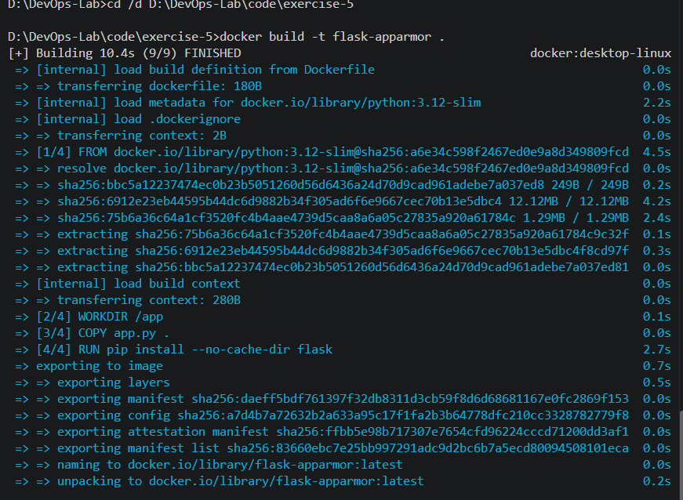

# Docker Hands-On Exercise Series

## Exercise 5: Docker Security with AppArmor and Python

## Objective

Understand Docker container security, inspect available security options, and test a Flask application running inside a Docker container.

## Scenario

A Python Flask web application is containerized using Docker. The objective is to explore AppArmor security profiles and understand how host platform support affects container security enforcement.

## Platform Finding: AppArmor Support

Docker security options were inspected using:

```cmd
docker info | findstr /i apparmor
docker info --format "{{json .SecurityOptions}}"
```

The security options reported by Docker were:

```json
["name=seccomp,profile=builtin","name=cgroupns"]
```

No AppArmor option was reported. This indicates that AppArmor support was not demonstrated in the current Docker Desktop environment.

AppArmor is a Linux security module. Its availability depends on the Linux kernel and runtime configuration underlying the Docker environment.


## Step 1: Create the Flask Application

File: `code/exercise-5/app.py`

```python
from flask import Flask

app = Flask(__name__)

@app.route("/")
def home():
    return "Hello, this is a secure Flask application running inside a Docker container!"

if __name__ == "__main__":
    app.run(host="0.0.0.0", port=5000)
```

The application responds to HTTP requests at the root endpoint.

## Step 2: Create the Dockerfile

File: `code/exercise-5/Dockerfile`

```dockerfile
FROM python:3.12-slim

WORKDIR /app

COPY app.py .

RUN pip install --no-cache-dir flask

EXPOSE 5000

CMD ["python", "app.py"]
```

The Dockerfile uses a lightweight Python image, installs Flask, copies the application into the container, and configures it to listen on port 5000.

## Step 3: Build the Docker Image

```cmd
docker build -t flask-apparmor .
```

The image was built successfully and named `flask-apparmor`.



## Step 4: Run the Container

```cmd
docker run -d --name flask-apparmor-test -p 5001:5000 flask-apparmor
```

The container was started in detached mode. Host port 5001 was mapped to container port 5000.

The container status and port mapping were verified using:

```cmd
docker ps
```

The output showed the Flask container running with the expected port mapping.

## Step 5: Test the Flask Application

```cmd
curl.exe http://localhost:5001/
```

Expected response:

```text
Hello, this is a secure Flask application running inside a Docker container!
```

The expected response was received successfully, confirming that the Flask application was accessible through the published host port.


## Step 6: Inspect Container Security Configuration

The available Docker security options were inspected using:

```cmd
docker info --format "{{json .SecurityOptions}}"
```

The container configuration was checked using:

```cmd
docker inspect flask-apparmor-test --format "{{json .HostConfig.SecurityOpt}}"
```

The second command returned `null`, indicating that no custom security options were configured for this container.

Therefore, this run did not demonstrate the enforcement of an AppArmor profile. A working AppArmor configuration would require a compatible Linux environment and a valid profile loaded into the host kernel.

## Step 7: Clean Up

The container was stopped and removed:

```cmd
docker stop flask-apparmor-test
docker rm flask-apparmor-test
```

Both commands completed successfully.

## Key Observations

- Docker successfully built and ran the Flask application.
- Port mapping enabled access to the application from the Windows host.
- Docker reported built-in seccomp and cgroup namespace security options.
- No AppArmor profile enforcement was demonstrated in this environment.
- Inspecting a container's configuration is not sufficient to prove that a security policy is actively enforced.

## Q&A

**Q1: What is AppArmor?**

AppArmor is a Linux security module that restricts application access to files, capabilities, and other system resources through defined security profiles.

**Q2: Why use AppArmor with Docker?**

AppArmor can add mandatory access controls to limit what a containerized application is allowed to do.

**Q3: Why was AppArmor enforcement not demonstrated here?**

The Docker environment did not report AppArmor support, and the container was run without a configured AppArmor profile.

**Q4: What is the purpose of Docker port mapping?**

Port mapping connects a port on the host machine to a port inside the container, making the application accessible externally.

**Q5: How can container security settings be inspected?**

Commands such as `docker info` and `docker inspect` reveal available runtime security options and the container's configured security settings. Actual enforcement must be verified separately.

## Conclusion

This exercise demonstrated building and running a Flask application in Docker, testing host-to-container connectivity, inspecting runtime security settings, and identifying the limitation of attempting to demonstrate AppArmor enforcement without confirmed host support.
