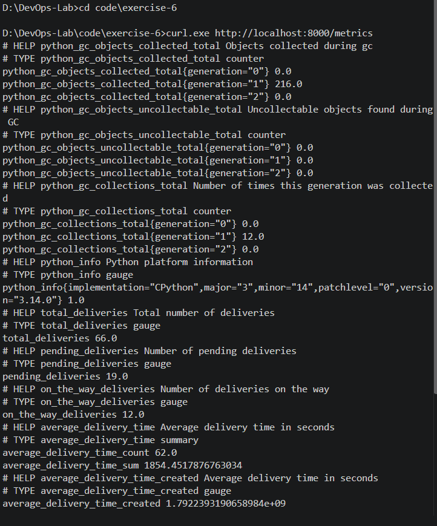
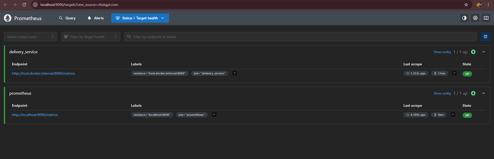
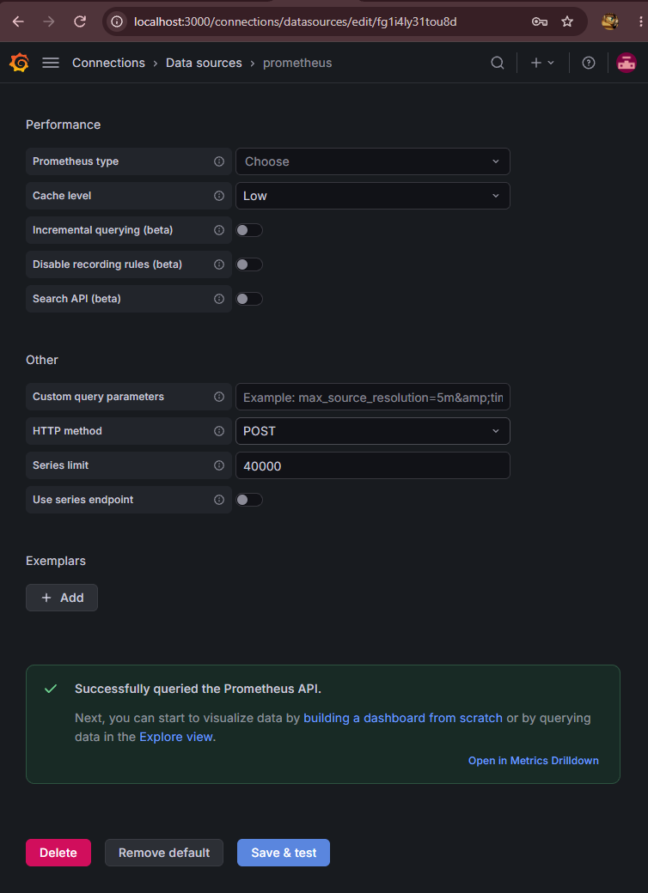

# Exercise 6: Real-Time Operations Monitoring and Alerting

## Objective

Build a monitoring system for a simulated delivery service using Python, Prometheus, and Grafana. The system generates live delivery metrics, collects them using Prometheus, and provides a foundation for visualizing performance and configuring alerts.

## Scenario

As a DevOps engineer at a delivery service, the task is to monitor delivery operations in real time. Metrics such as total deliveries, pending deliveries, deliveries on the way, and average delivery time help identify operational issues.

## Step 1: Generate Delivery Metrics Using Python

Created `delivery_metrics.py` using the `prometheus_client` Python library.

The application generates simulated delivery data and exposes the metrics through an HTTP endpoint on port 8000.

Custom metrics include:

- `total_deliveries` — total deliveries.
- `pending_deliveries` — deliveries awaiting processing.
- `on_the_way_deliveries` — deliveries currently in transit.
- `average_delivery_time` — delivery-time observations.

## Step 2: Verify the Metrics Endpoint

Executed the following command:

```bash
curl.exe http://localhost:8000/metrics
```

The endpoint returned the custom delivery metrics along with Python's default process metrics.



**Result:** The Python metrics exporter is working successfully.

## Step 3: Configure Prometheus

Created `prometheus.yml` with two scrape jobs:

- `prometheus` — monitors Prometheus itself.
- `delivery_service` — collects metrics from `host.docker.internal:8000`.

Created `alert_rules.yml` with two alert rules:

- `HighPendingDeliveries` — triggers when pending deliveries exceed 10 for 15 seconds.
- `HighAverageDeliveryTime` — triggers when average delivery time exceeds 30 seconds for 15 seconds.

## Step 4: Run Prometheus in Docker

Started Prometheus using Docker with port 9090 exposed and the configuration files mounted into the container.

The `host.docker.internal` hostname was configured to allow Prometheus to access the Python metrics exporter running on the host.



**Result:** Both `prometheus` and `delivery_service` targets showed **UP**, confirming successful metric collection.

## Step 5: Configure Grafana

Started Grafana in Docker and accessed its web interface at `http://localhost:3000`.

Added Prometheus as a Grafana data source using:

`http://host.docker.internal:9090`



**Result:** Grafana successfully queried the Prometheus API.

## Implementation Status

The Python metrics exporter, Prometheus container, target scraping, and Grafana data-source connection were verified successfully.

The Grafana dashboard visualization and final alert-state verification remain pending.

## Key Observations

- Python can expose application-specific metrics through an HTTP endpoint.
- Prometheus periodically scrapes metrics and evaluates configured alert rules.
- Grafana can use Prometheus as a data source for operational dashboards.
- Monitoring delivery metrics helps identify increases in pending orders and delivery delays.
- Docker provides a convenient way to run the monitoring components independently.

## Conclusion

This exercise established the core components of a real-time monitoring pipeline using Python, Prometheus, Docker, and Grafana. The metrics endpoint was verified, both Prometheus targets were healthy, and Grafana successfully connected to Prometheus. Dashboard visualization and final alert verification are the remaining steps.
