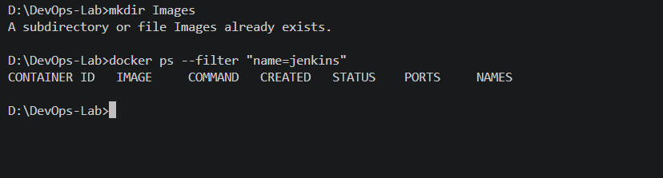
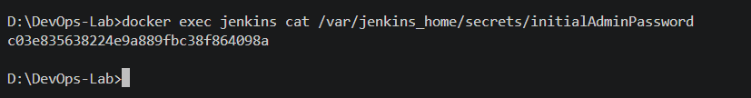
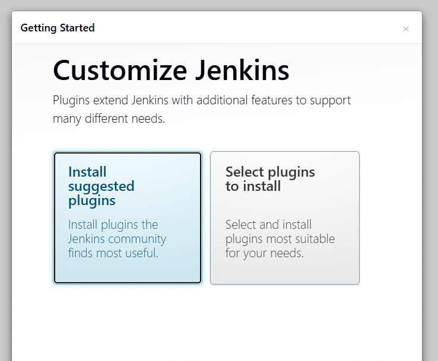
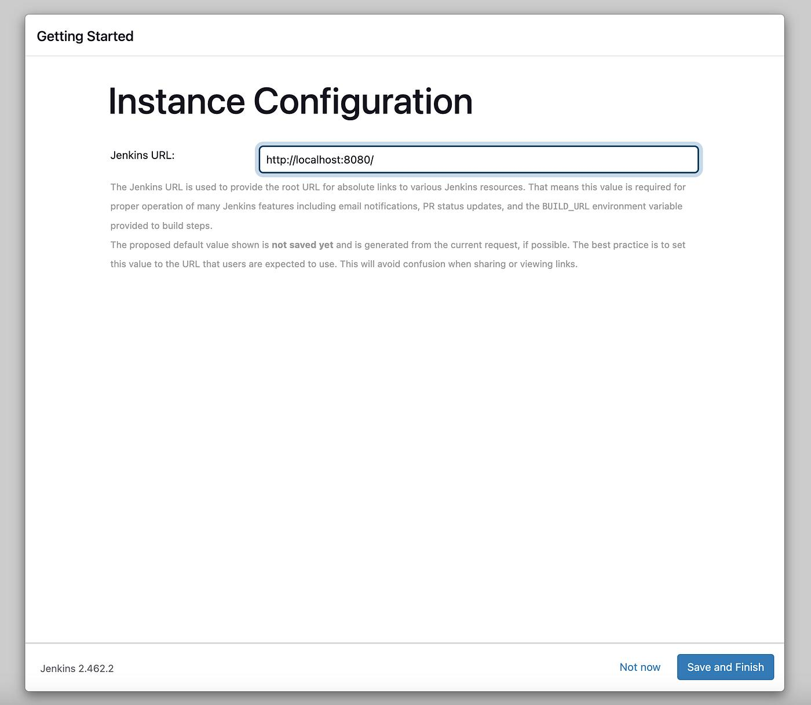
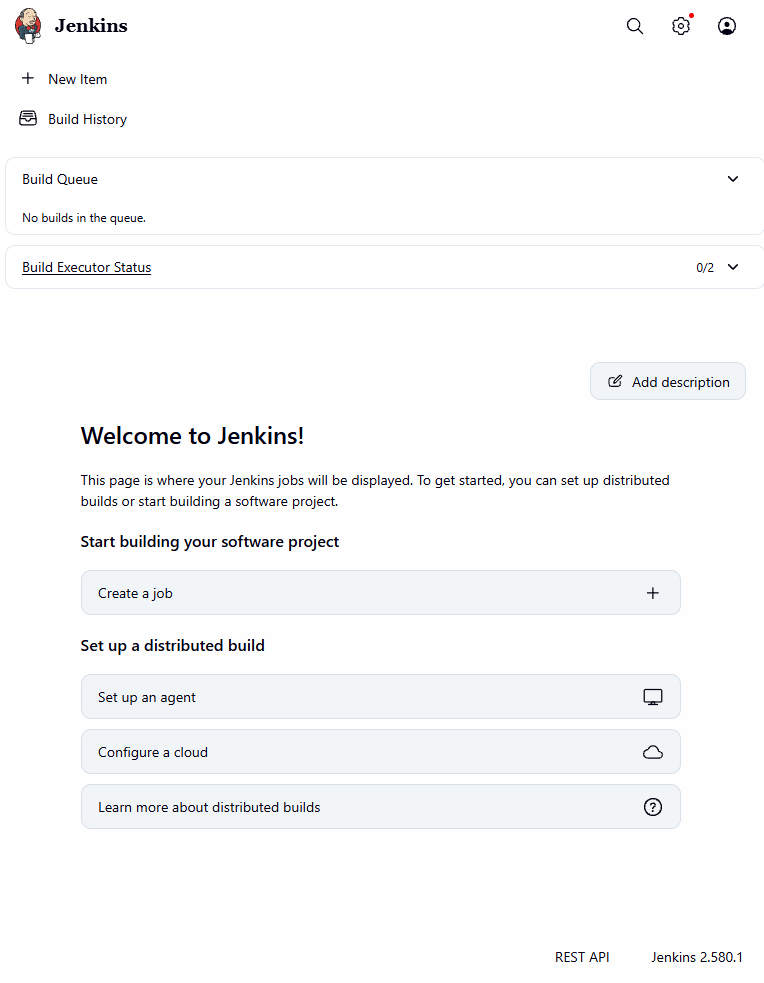

# Exercise 7: Introduction to Continuous Integration (CI) and Jenkins Installation

## Objective

Understand Continuous Integration (CI), learn the basic concepts of Jenkins, and install and configure Jenkins using Docker.

## What is Continuous Integration (CI)?

Continuous Integration is a software development practice in which developers frequently integrate code changes into a shared repository. Automated builds and tests help detect errors early and improve software quality.

## Key Features of CI

- **Frequent Code Integration:** Developers regularly commit changes to a shared repository.
- **Automated Builds:** Code is automatically built when changes are integrated.
- **Automated Testing:** Tests run to detect bugs and regressions.
- **Immediate Feedback:** Developers receive information about build and test results.

## Benefits of CI

- Early detection of bugs.
- Improved collaboration among developers.
- Faster development cycles.
- Improved software quality through automated testing.

## How CI Works

1. A developer pushes code to a version control system such as Git.
2. A CI server detects the changes.
3. The application is built and dependencies are installed.
4. Automated tests are executed.
5. The results are reported to the development team.

## What is Jenkins?

Jenkins is an open-source automation server used to automate building, testing, and deploying software. It supports Continuous Integration and Continuous Delivery through jobs, pipelines, and plugins.

## Key Jenkins Concepts

- **Job:** A task configured to run in Jenkins.
- **Build:** An execution of a job.
- **Pipeline:** A sequence of automated build, test, and deployment stages.
- **Plugins:** Extensions that add functionality to Jenkins.
- **Nodes and Agents:** Machines that execute Jenkins jobs.

## Installing Jenkins Using Docker

### Step 1: Run the Jenkins container

Command:

```bash
docker run -d --name jenkins -p 8080:8080 -p 50000:50000 jenkins/jenkins:lts
```

This command downloads the Jenkins image if necessary and starts Jenkins in a Docker container.


### Step 2: Verify the container is running

Command:

```bash
docker ps --filter "name=jenkins"
```

The container status should show `Up`, indicating that Jenkins is running.



### Step 3: Retrieve the initial administrator password

Command:

```bash
docker exec jenkins cat /var/jenkins_home/secrets/initialAdminPassword
```

The command displays the initial administrator password required to unlock a fresh Jenkins installation.



### Step 4: Access Jenkins and unlock it

Open the following URL in a browser:

http://localhost:8080

Enter the initial administrator password when prompted.


### Step 5: Install suggested plugins

Choose **Install suggested plugins** to install commonly used Jenkins plugins. Wait until the installation process finishes.



### Step 6: Configure the administrator account and Jenkins URL

Create an administrator account and configure the Jenkins URL.

The default URL for local access is:

`http://localhost:8080/`

Save the configuration and finish the setup wizard.



### Step 7: Verify the Jenkins dashboard

After setup, Jenkins displays its main dashboard. The dashboard provides access to job creation, build history, and other Jenkins features.



Jenkins is now installed and accessible locally, ready for creating and executing automation jobs.

## Result

Jenkins was successfully installed and configured using Docker. The container was verified as running, and the Jenkins dashboard was accessed through a web browser.

The exercise introduced the fundamental concepts of Continuous Integration, Jenkins jobs, builds, pipelines, and plugins.

## Conclusion

This exercise demonstrated the installation and initial configuration of Jenkins as a CI automation server. The next step is to create a Jenkins pipeline that automates application building and testing.

## Future Scope

A Jenkinsfile can be used to define pipeline stages for source-code checkout, dependency installation, automated testing, Docker image building, and deployment.