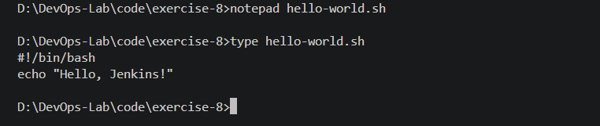
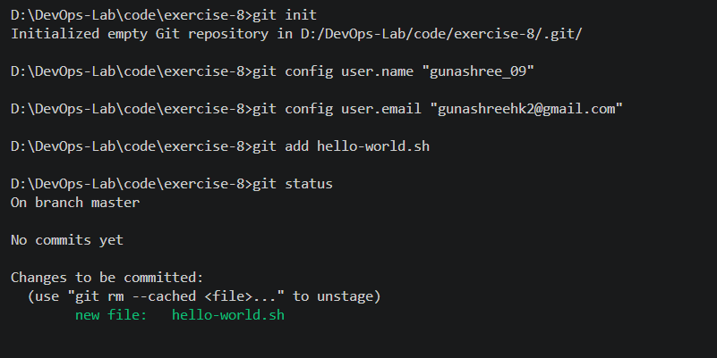
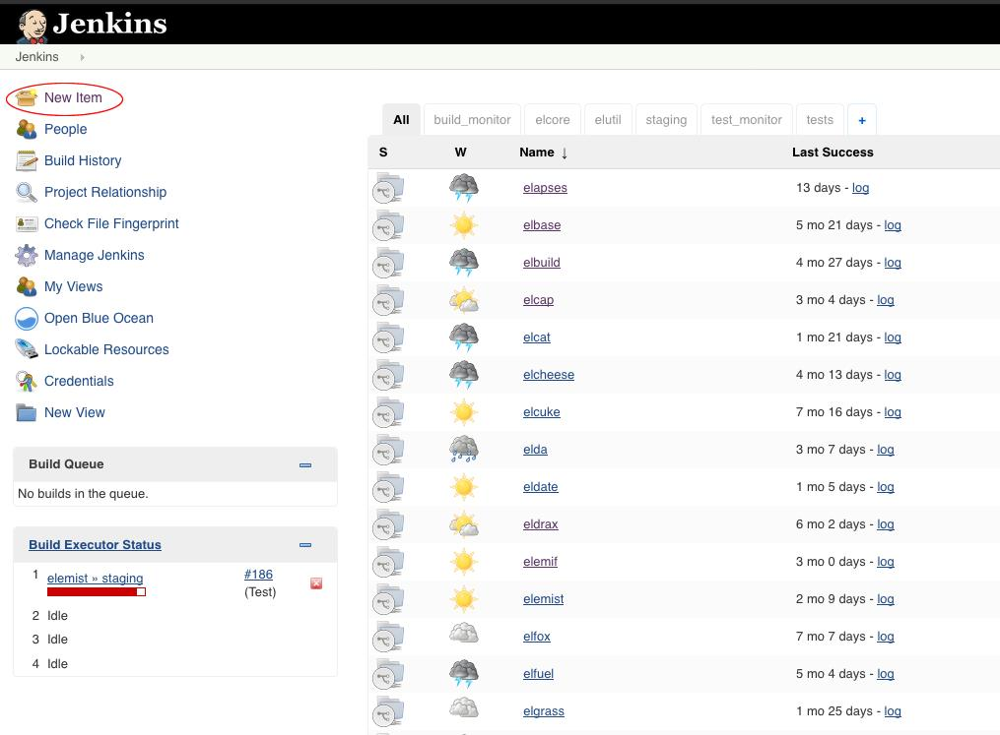
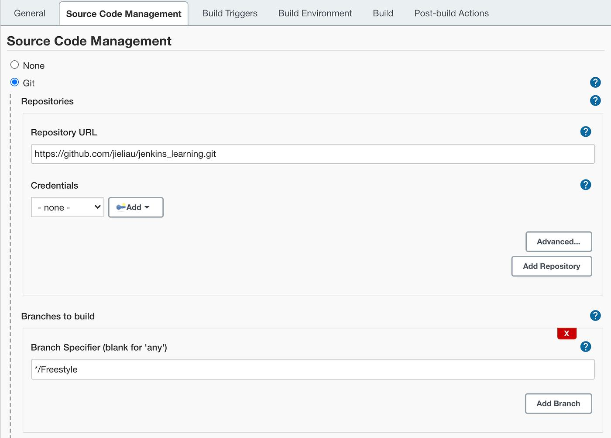
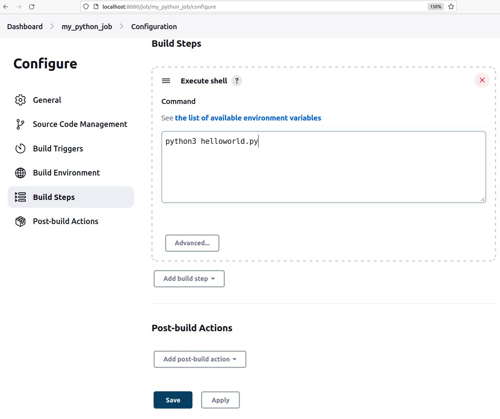
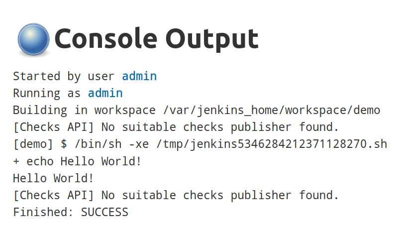

# Exercise 8: Creating a Hello World Jenkins Job

## 1. Objective

To integrate GitHub with Jenkins by creating a shell script, storing it in a GitHub repository, and configuring a Jenkins Freestyle job to retrieve and execute the script. This exercise demonstrates the basic principles of Continuous Integration (CI).

## 2. Tools and Technologies Used

- **Version Control:** Git
- **Source Code Hosting:** GitHub
- **CI Automation Server:** Jenkins
- **Containerization:** Docker
- **Scripting Language:** Bash
- **Code Editor:** Visual Studio Code
- **Operating System:** Windows

## 3. Procedure

### Step 1: Create the Shell Script

Created a shell script named `hello-world.sh` inside the `code/exercise-8/` directory.

**Script:**

```bash
#!/bin/bash
echo "Hello, Jenkins!"
```

The script prints a greeting when executed.



### Step 2: Initialize the Git Repository

Initialized Git and configured the user details. Added the shell script to the staging area and verified its status.

**Commands:**

```bash
git init
git config user.name "YOUR_NAME"
git config user.email "YOUR_EMAIL"
git add hello-world.sh
git status
```

The status command confirmed that the shell script was staged and ready to commit.



### Step 3: Commit and Push the Script to GitHub

Committed the script and pushed it to the existing GitHub repository, `DevOps-Lab`.

**Commands:**

```bash
git commit -m "Add hello-world.sh"
git branch -M main
git add code/exercise-8
git commit -m "Add Exercise 8 Hello World Jenkins script"
git push origin main
```

The existing repository was used to maintain all DevOps exercises in one place.

**GitHub Repository:** [gunashree-09/DevOps-Lab](https://github.com/gunashree-09/DevOps-Lab)


### Step 4: Verify Jenkins Installation

Verified that the Jenkins Docker container was running and accessed the Jenkins dashboard through the browser.

**Command:**

```cmd
docker ps -a --filter "name=jenkins"
```

Jenkins was accessed at:

`http://localhost:8080`



### Step 5: Create a Freestyle Job

Created a new Jenkins Freestyle project named `HelloWorld`.

Under **Source Code Management**, selected Git and configured the repository URL:

`https://github.com/gunashree-09/DevOps-Lab.git`

Set the branch specifier to:

`*/main`

Since the repository is public, no additional Git credentials were required.



### Step 6: Configure the Build Step

Added an **Execute shell** build step to execute the shell script from the checked-out repository.

**Command:**

```bash
sh code/exercise-8/hello-world.sh
```

This path is used because the script is stored inside the `code/exercise-8/` directory of the repository.



### Step 7: Execute and Verify the Build

Selected **Build Now** to execute the job and inspected the Console Output of the latest build.

**Expected output:**

```text
Hello, Jenkins!
Finished: SUCCESS
```

The output confirms that Jenkins retrieved the repository, located the script, and executed it successfully.



## 4. Result

Successfully configured a Jenkins Freestyle job integrated with the existing GitHub repository. The job retrieves the source code and executes the shell script, demonstrating a basic Continuous Integration workflow.

## 5. Conclusion

This exercise demonstrated the integration of Git, GitHub, Docker-based Jenkins, and Bash scripting. It provided practical experience with source code management, Jenkins job configuration, build execution, and verification through console logs.

The exercise establishes the foundation for more advanced CI/CD pipelines involving automated testing, Docker image creation, and application deployment.