# Exercise 9: Jenkins Multi-Stage Pipeline — Deploying a Python Application

## Objective

To build a Jenkins **Pipeline job** that automates the build, testing, deployment, execution, and post-deployment verification of a Python Flask application. The exercise demonstrates a multi-stage Continuous Integration and Continuous Deployment (CI/CD) workflow using Jenkins, Git, GitHub, Python, and Docker.

## Scenario

The objective is to automate the lifecycle of a Python Flask application through five stages:

1. **Build** — Create a Python virtual environment and install dependencies.
2. **Test** — Run unit tests against the source application.
3. **Deploy** — Copy the application files to a mock deployment directory.
4. **Run Application** — Start the deployed application in the background.
5. **Test Application** — Verify the deployed copy using unit tests and an HTTP request.

## Step 1: Create the Project Directories

The project was organized using Visual Studio Code and Command Prompt on Windows 11.

The following commands were executed in the VS Code terminal using CMD:

```bat
cd /d D:\DevOps-Lab
mkdir code\exercise-09
mkdir Images\exercise-9
```

The directories were created to store the application source code, screenshots, and report separately.

Project structure:

```text
D:\DevOps-Lab
├── code
│   └── exercise-09
│       ├── app.py
│       ├── requirements.txt
│       ├── test_app.py
│       └── Jenkinsfile
├── Images
│   └── exercise-9
└── Exercise-9.md
```

### Screenshot 1: Project Directories

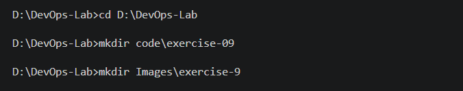

*Figure 1: Project directories created for Exercise 9.*

## Step 2: Create the Flask Application

The Flask application was created in `code/exercise-09/app.py`.

### File: `app.py`

```python
from flask import Flask

app = Flask(__name__)


@app.route("/")
def home():
    return "Hello, Jenkins Multi-Stage Pipeline!"


if __name__ == "__main__":
    app.run(host="0.0.0.0", port=5000, debug=False)
```

The application defines a home route (`/`) that returns a text response. It listens on port 5000 when executed.

### Screenshot 2: Flask Application

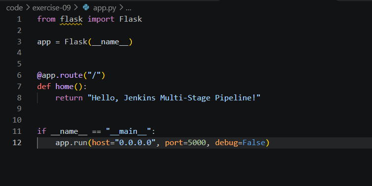

*Figure 2: Flask application implemented in Python.*

## Step 3: Configure Dependencies and Unit Tests

A dependency file and a unit test file were created to support the automated testing process.

### File: `requirements.txt`

```text
Flask==3.1.1
```

This file specifies the Flask version required by the application.

### File: `test_app.py`

```python
import unittest
from app import app


class TestApp(unittest.TestCase):

    def test_home(self):
        tester = app.test_client()
        response = tester.get("/")

        self.assertEqual(response.status_code, 200)
        self.assertEqual(
            response.data.decode("utf-8"),
            "Hello, Jenkins Multi-Stage Pipeline!"
        )


if __name__ == "__main__":
    unittest.main()
```

The unit test uses Flask's test client to send a request to the home route. It verifies that the response status is `200` and that the returned message matches the expected output.

### Screenshot 3: Unit Test Code

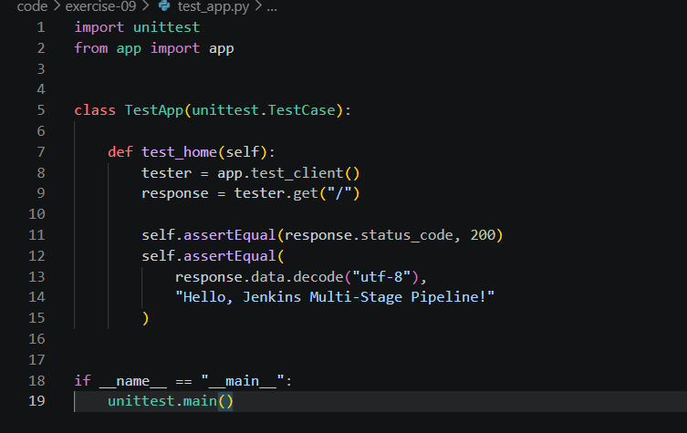

*Figure 3: Unit test for the Flask application.*

## Step 4: Test the Application Locally

Before configuring Jenkins, the application was tested on the Windows development machine.

The following commands were executed in the VS Code CMD terminal:

```bat
cd /d D:\DevOps-Lab

py --version

py -m venv code\exercise-09\.venv

code\exercise-09\.venv\Scripts\python.exe -m pip install -r code\exercise-09\requirements.txt

code\exercise-09\.venv\Scripts\python.exe -m unittest discover -s code\exercise-09 -p "test_*.py"
```

The virtual environment isolates the Python dependencies used for local testing.

Expected test result:

```text
Ran 1 test
OK
```

### Screenshot 4: Local Test Results

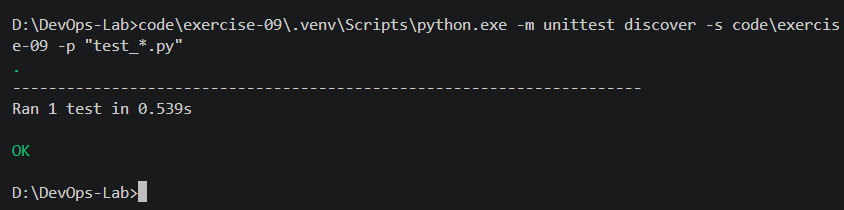

*Figure 4: Successful execution of the Flask unit test on Windows.*

## Step 5: Create the Jenkinsfile

A file named `Jenkinsfile` was created in `code/exercise-09`. It defines the complete CI/CD workflow as code.

### File: `Jenkinsfile`

```groovy
pipeline {
    agent any

    environment {
        DEPLOY_DIR = "${WORKSPACE}/python-app-deploy"
        APP_PORT = "5000"
    }

    stages {
        stage('Build') {
            steps {
                echo 'Installing Python dependencies...'
                sh '''
                    python3 -m venv .venv
                    .venv/bin/python -m pip install -r code/exercise-09/requirements.txt
                '''
            }
        }

        stage('Test') {
            steps {
                echo 'Running unit tests...'
                sh '''
                    PYTHONPATH="$WORKSPACE/code/exercise-09" \
                    .venv/bin/python -m unittest discover \
                    -s code/exercise-09 -p "test_*.py"
                '''
            }
        }

        stage('Deploy') {
            steps {
                echo 'Deploying application...'
                sh '''
                    mkdir -p "$DEPLOY_DIR"
                    cp code/exercise-09/app.py "$DEPLOY_DIR/"
                    cp code/exercise-09/test_app.py "$DEPLOY_DIR/"
                    cp code/exercise-09/requirements.txt "$DEPLOY_DIR/"
                '''
            }
        }

        stage('Run Application') {
            steps {
                echo 'Starting deployed application...'
                sh '''
                    cd "$DEPLOY_DIR"

                    nohup "$WORKSPACE/.venv/bin/python" app.py \
                        > app.log 2>&1 &

                    echo $! > app.pid

                    for i in $(seq 1 30); do
                        if "$WORKSPACE/.venv/bin/python" -c \
                        "import urllib.request; urllib.request.urlopen('http://127.0.0.1:${APP_PORT}', timeout=2)" \
                        2>/dev/null; then
                            echo "Application started successfully"
                            exit 0
                        fi
                        sleep 1
                    done

                    cat app.log
                    exit 1
                '''
            }
        }

        stage('Test Application') {
            steps {
                echo 'Testing deployed application...'
                sh '''
                    cd "$DEPLOY_DIR"

                    PYTHONPATH="$DEPLOY_DIR" \
                    "$WORKSPACE/.venv/bin/python" \
                    -m unittest discover -s . -p "test_*.py"

                    "$WORKSPACE/.venv/bin/python" -c "
import urllib.request
with urllib.request.urlopen('http://127.0.0.1:${APP_PORT}', timeout=5) as response:
    body = response.read().decode()
    assert response.status == 200
    assert body == 'Hello, Jenkins Multi-Stage Pipeline!'
    print('Live application test passed:', body)
"
                '''
            }
        }
    }

    post {
        success {
            echo 'Pipeline completed successfully!'
        }

        failure {
            echo 'Pipeline failed. Check Console Output.'
        }

        always {
            sh '''
                if [ -f "$DEPLOY_DIR/app.pid" ]; then
                    kill "$(cat "$DEPLOY_DIR/app.pid")" 2>/dev/null || true
                fi
            '''
        }
    }
}
```

### Explanation of the Jenkins Pipeline

| Stage | Description |
|---|---|
| Build | Creates a virtual environment and installs the dependencies from `requirements.txt`. |
| Test | Runs the unit test against the source application. |
| Deploy | Copies the Python application, tests, and dependency file into `python-app-deploy`. |
| Run Application | Starts the deployed Flask application and waits for it to respond. |
| Test Application | Re-runs the unit test and checks the live HTTP response. |

The `post` section prints a success or failure message and attempts to stop the background application after the pipeline completes.

### Screenshot 5: Jenkinsfile

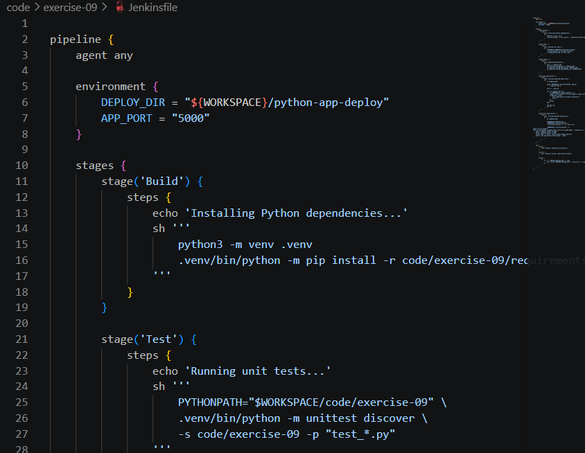

*Figure 5: Jenkinsfile defining the five pipeline stages.*

## Step 6: Push the Source Files to GitHub

The four source files were added to the existing GitHub repository.

The commands were executed from the VS Code CMD terminal:

```bat
cd /d D:\DevOps-Lab

git status
git remote -v
git branch --show-current

git add code/exercise-09/app.py
git add code/exercise-09/requirements.txt
git add code/exercise-09/test_app.py
git add code/exercise-09/Jenkinsfile

git status

git commit -m "Add Flask app, tests, and Jenkinsfile for multi-stage pipeline"

git push origin HEAD
```

The Git commands stage the source files, create a commit, and push the changes to the current branch of the existing remote repository.

### Screenshot 6: GitHub Push


*Figure 6: Git commit and push output for the Exercise 9 source files.*

## Step 7: Check Docker and Install Python in Jenkins

The Jenkins server was run inside a Docker container. The container was checked using:

```bat
docker ps
```

The running Jenkins container was identified before installing Python.

The following command was executed from Windows CMD, assuming the container name was `jenkins`:

```bat
docker exec -u 0 jenkins bash -lc "apt-get update && apt-get install -y python3 python3-venv python3-pip python3-flask"
```

Python was verified using:

```bat
docker exec jenkins python3 --version

docker exec jenkins python3 -c "import flask; print(flask.__version__)"
```

The standard Jenkins image may not include Python by default, so the Python runtime and related packages were installed inside the running container.

The pipeline subsequently creates its own virtual environment and installs the Flask dependency from the project's requirements file.

**Note:** This installation changes the running container. Removing and recreating the container may require reinstalling Python. A custom Jenkins image with Python preinstalled would provide a more reproducible setup.

### Screenshot 7: Running Jenkins Container

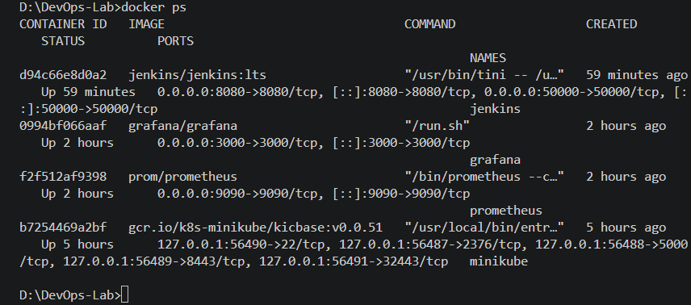

*Figure 7: Jenkins container running in Docker.*

### Screenshot 8: Python Verification

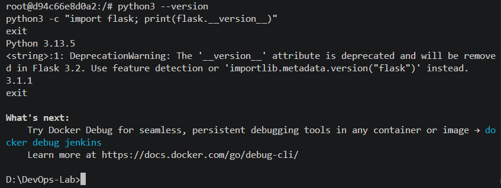

*Figure 8: Python and Flask version verification inside the Jenkins container.*

## Step 8: Create the Jenkins Pipeline Job

The Jenkins web interface was opened at:

`http://localhost:8080`

A new job was created using the following procedure:

1. Select **New Item**.
2. Enter `Python-MultiStage-Pipeline` as the job name.
3. Select **Pipeline**.
4. Click **OK**.

A Pipeline job was selected because the build process is defined in a Jenkinsfile stored in source control.

### Screenshot 9: Jenkins Pipeline Job

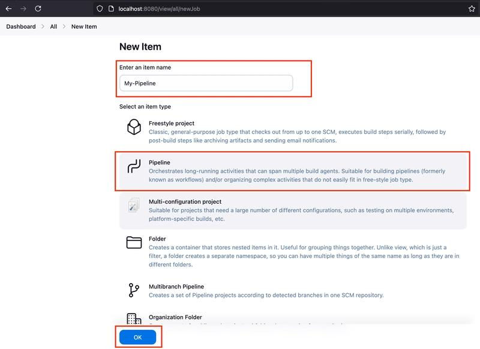

*Figure 9: Jenkins Pipeline job creation.*

## Step 9: Configure Pipeline from SCM

The job was configured to retrieve its Jenkinsfile from the existing GitHub repository.

Under the Pipeline configuration section, the following settings were used:

| Setting | Value |
|---|---|
| Definition | Pipeline script from SCM |
| SCM | Git |
| Repository URL | Existing GitHub repository URL |
| Credentials | Configured credentials if the repository is private |
| Branch Specifier | `*/main`, if the repository branch is `main` |
| Script Path | `code/exercise-09/Jenkinsfile` |

The branch and repository URL must match the existing Git configuration. The Script Path is relative to the repository root.

After entering the settings, the configuration was saved.

### Screenshot 10: Pipeline SCM Configuration

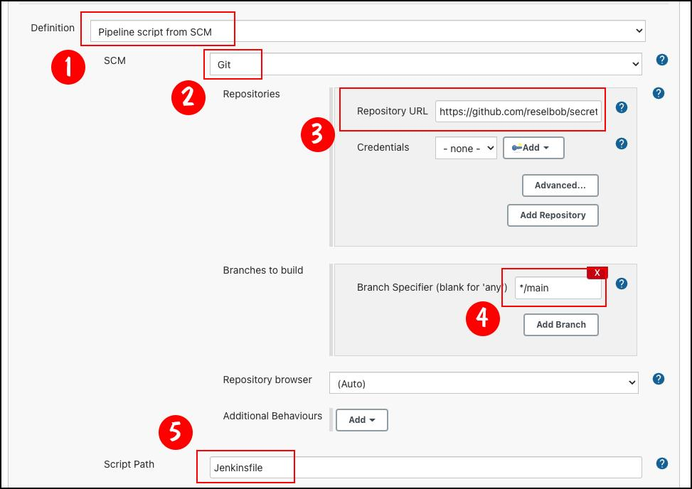

*Figure 10: Jenkins configured to retrieve the Jenkinsfile from GitHub.*

## Step 10: Execute the Pipeline

The Jenkins job was opened and **Build Now** was selected to trigger the pipeline.

The build was monitored through Build History and Console Output.

The pipeline was expected to execute the following stages in sequence:

1. Build
2. Test
3. Deploy
4. Run Application
5. Test Application

The source tests verify the application response. The deployment stage copies the application files to the mock deployment directory. The Run Application stage starts the Flask server, and the final stage verifies both the deployed unit test and the live HTTP endpoint.

### Screenshot 11: Successful Pipeline Run

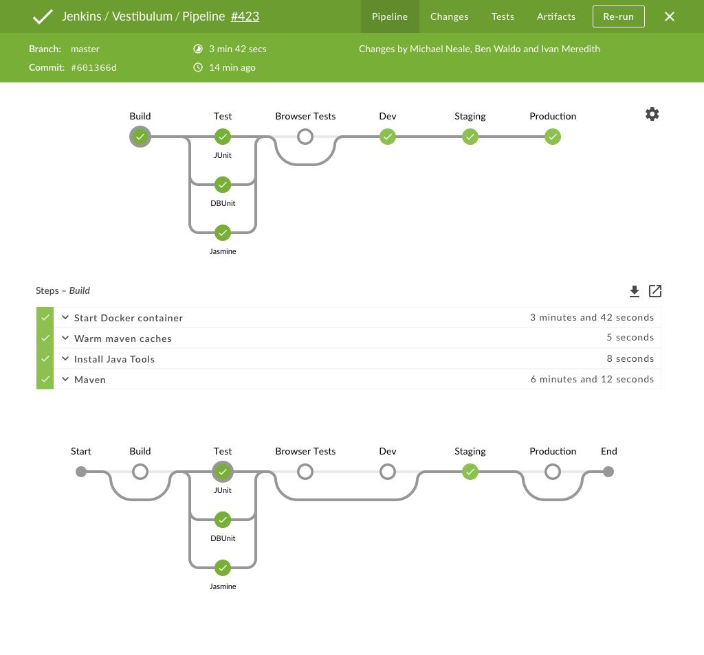

*Figure 11: Jenkins Stage View showing the pipeline execution.*

### Screenshot 12: Jenkins Console Output

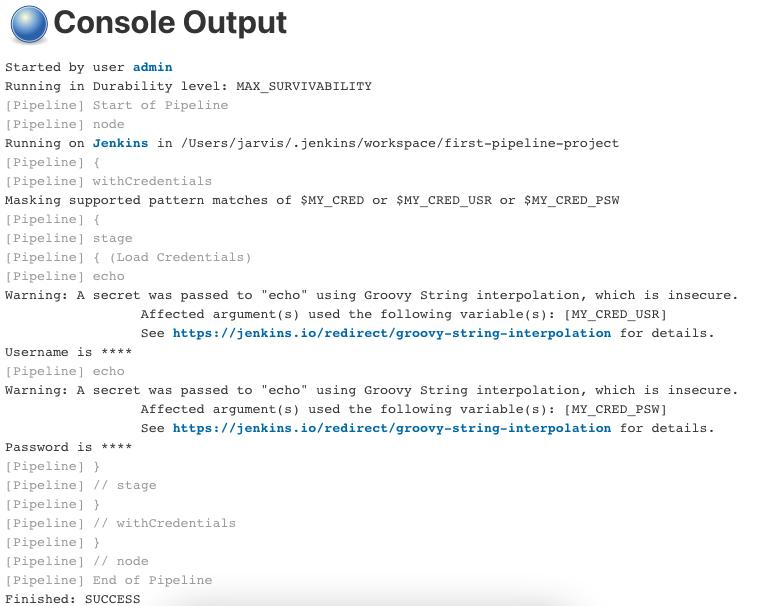

*Figure 12: Jenkins Console Output showing the pipeline execution and final status.*

The successful final status should be:

```text
Pipeline completed successfully!
Finished: SUCCESS
```

The actual build must complete successfully before this result is recorded as verified.

## Step 11: Push the Report and Screenshots

After capturing the screenshots, the report and image files were added to Git.

The following commands were executed in the VS Code CMD terminal:

```bat
cd /d D:\DevOps-Lab

git add Exercise-9.md
git add Images/exercise-9

git status

git commit -m "Add Exercise 9 report and screenshots"

git push origin HEAD
```

The Git status was checked before committing to verify that the intended files were staged.

## 12. Final Project Structure

The completed exercise uses the following directory structure:

```text
D:\DevOps-Lab
│
├── code
│   └── exercise-09
│       ├── app.py
│       ├── requirements.txt
│       ├── test_app.py
│       └── Jenkinsfile
│
├── Images
│   └── exercise-9
│       ├── 01-project-directories.png
│       ├── 03-flask-application.png
│       ├── 04-unit-test-code.png
│       ├── 05-jenkinsfile.png
│       ├── 06-local-tests-passed.png
│       ├── 07-docker-jenkins.png
│       ├── 08-jenkins-container-python-verify.png
│       ├── 09-github-push.png
│       ├── 10-jenkins-pipeline-job.png
│       ├── 11-jenkins-scm-config.png
│       ├── 12-jenkins-pipeline-success.png
│       └── 13-jenkins-console-output.png
│
└── Exercise-9.md
```

## 13. Result

The Jenkins Pipeline is designed to automate dependency installation, source testing, mock deployment, application startup, and post-deployment verification.

The exercise is considered successful when all five stages complete without errors and Jenkins reports `Finished: SUCCESS`.

## 14. Conclusion

This exercise demonstrates the use of Jenkins Pipeline as Code to automate a Python application's CI/CD workflow. It integrates GitHub source control, Python dependency management, automated unit testing, mock deployment, application execution, and post-deployment verification.

The exercise also demonstrates that Jenkins containers require the appropriate runtime dependencies and that container modifications should be made reproducible for long-term use.

## 15. Future Enhancements

- Add a code quality stage using Flake8 or Pylint.
- Package the Flask application into a Docker image.
- Deploy the application to a separate container or server.
- Configure email or Slack notifications for build results.
- Build a custom Jenkins image with Python preinstalled.
